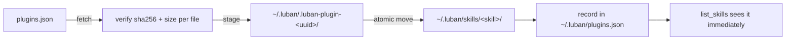

<div align="center">


# luban-plugins

**A shelf of skill packs for [luban](https://github.com/holylong/luban) — one JSON catalog, one click to install.**

[](LICENSE)
[](plugins)
[](plugins.json)
[](https://github.com/holylong/luban/releases)

[English](README.md) · [简体中文](README.zh-CN.md)

</div>

---

A luban plugin is a **skill pack**: a handful of `SKILL.md` files that land in `~/.luban/skills/` and that the
agent loads on demand through `list_skills` / `read_skill`. No binaries, no hooks, no background process —
just instructions the model reads when a task calls for them.

The desktop app reads this repo's `plugins.json` directly, so the status bar's
**Plugins** panel is a searchable list you can install, update and uninstall from.

## The catalog

| Plugin | What you get | Versions | Skills |
| --- | --- | --- | --- |
| **[Code review](plugins/code-review)**<br><sub>`code-review`</sub> | Reads the callers first, then walks correctness → error handling → concurrency → resources → testability. Reports only what it can make reproducible, each with a concrete fix. | 1.0.0 | `code-review` |
| **[Chinese commit messages](plugins/commit-style-zh)**<br><sub>`commit-style-zh`</sub> | Subject line plus a body that explains *why*, with good/bad examples and a self-check list. | 1.0.0 | `commit-style-zh` |
| **[SQL & index review](plugins/sql-review)**<br><sub>`sql-review`</sub> | Explains the plan before rewriting, spots implicit casts, leading wildcards and wrong composite-index order, and hands back a rewrite you can verify. | 1.0.0 | `sql-review` |
| **[Changelog writing](plugins/changelog-writer)**<br><sub>`changelog-writer`</sub> | Turns a git history into release notes: grouped by user-visible change, refactor noise filtered out, breaking changes with migration notes. | 1.0.0 | `changelog-writer` |
| **[CSV & TSV reading](plugins/csv-preview)**<br><sub>`csv-preview`</sub> | Checks the bytes before parsing (BOM, line endings, real separator), then walks each column for type, missing values and outliers and hands back a command you can run. | 1.0.0 | `csv-preview` |

Every skill is plain markdown in this repo — read the `SKILL.md` under `plugins/<id>/skills/` before installing.

## Install

| Entry point | How |
| --- | --- |
| **Desktop** | Status bar → **Plugins** → type to filter → **Install** / **Update** / **Uninstall** |
| **Config file** | `~/.luban/config.json` → `"plugins": { "registry": "https://…/plugins.json" }` |
| **Environment** | `LUBAN_PLUGIN_REGISTRY=https://…/plugins.json` |

The default catalog:

```
https://raw.githubusercontent.com/holylong/luban-plugins/main/plugins.json
```

Point `plugins.registry` at your own JSON to run a private mirror — the layout below is all it takes.

## How installing works



1. Fetch the catalog once (cached by the app, refreshed on demand).
2. Download each `files[].url` and compare `sha256` **and** byte length — a mismatch aborts before anything is written.
3. Stage into a temporary directory inside `~/.luban/`, so a failed install leaves no half-plugin behind.
4. Move the skill folders into place atomically.
5. Record ownership in `~/.luban/plugins.json`. Uninstalling removes only those folders, so hand-written skills are never touched.

## Repository layout

```
plugins.json                      # the catalog — generated, never hand-edited
plugins/<id>/plugin.json          # name, version, description, tags
plugins/<id>/skills/<skill>/…     # the files that actually get installed
scripts/build-index.mjs           # regenerates the catalog and every sha256
assets/                           # logo used by this README
```

## Publish a plugin

```bash
mkdir -p plugins/my-plugin/skills/my-skill
$EDITOR plugins/my-plugin/plugin.json                 # id / name / version / description / tags
$EDITOR plugins/my-plugin/skills/my-skill/SKILL.md    # the instructions themselves
node scripts/build-index.mjs                          # rewrite plugins.json, recompute hashes
node scripts/build-index.mjs --check                  # what CI runs: fail if the catalog is stale
```

<details>
<summary><b>plugin.json format</b></summary>

```json
{
  "id": "my-plugin",
  "name": "My plugin",
  "version": "1.0.0",
  "description": "One sentence on what the user gains.",
  "author": "you",
  "license": "MIT",
  "homepage": "https://github.com/holylong/luban-plugins/tree/main/plugins/my-plugin",
  "tags": ["git", "docs"]
}
```

| Rule | Detail |
| --- | --- |
| `id` | Must equal the folder name: lowercase letters, digits, `.`, `_`, `-` |
| Files | Must live under `skills/<skill>/…`; that prefix is stripped on install |
| Frontmatter | Each `SKILL.md` needs `name` and `description` |
| Size | 512 KB per file, 64 files per plugin |
| Version | Bump it and clients show **Update available** |

</details>

## Safety

- A plugin is markdown only: it adds no tools, executes no code, and runs nothing on its own.
- Skill text **is read as instructions**, i.e. it behaves like a prompt. Review a `SKILL.md` before installing one from someone else, especially in a PR.
- Self-host the catalog for anything internal: one static `plugins.json` plus the skill files.

## License

MIT for the catalog and tooling; each plugin declares its own license in `plugin.json` (unlabelled plugins are treated as MIT).

<div align="center"><sub>Catalog: <code>plugins.json</code> · built with <a href="scripts/build-index.mjs">scripts/build-index.mjs</a></sub></div>
